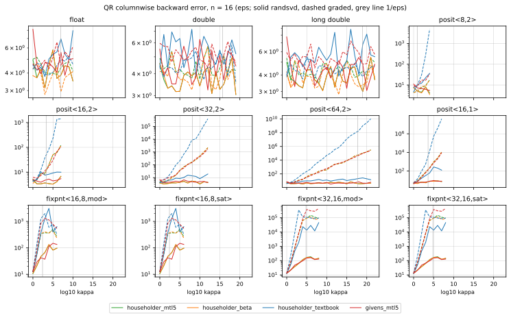
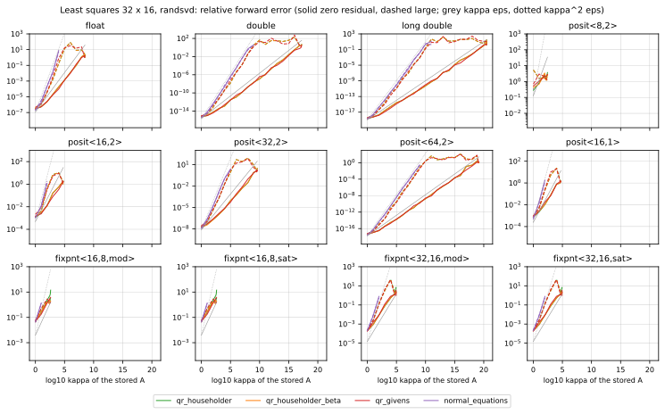

# QR and least squares across number systems

mp-numerics#14, part 1 of 6, in the series that stillwater-sc/mtl5#666 tracks. The
operator study (#13, `../givens_householder/`) measured one Givens rotation or
one Householder reflector at a time. This one measures the factorizations
built from them. It factors the same matrices in each number type by QR and
solves the same least-squares problems by QR and by the normal equations. It
then asks where each type stops being usable, and whether the method or the
type decides that.

Part 1 covers the hardware IEEE types, posits and fixed point, 12 types in all.
Part 2 adds the cfloat matrix, lns, takum, dd and qd. The later parts cover
Hessenberg and Schur, the SVD, banded and sparse inputs, and the findings note
for the MTL5 docs.

## Running it

```bash
cmake --build build --target decompositions_study
./build/benchmarks/linalg/decompositions/decompositions_study results/
python3 benchmarks/linalg/decompositions/summarize.py results/
python3 benchmarks/linalg/decompositions/plot.py results/ figures/
```

- **Options:** `--quick` runs a small sample. `--family ieee,posit,fixpnt` picks
  families; all of them run by default.
- **Run time:** the full run takes about 11 minutes on one core. Most of it
  is the exact measurement and the qd condition numbers at n = 16 and 32 × 16.
- **Sidecars:** each CSV has a `.sysinfo` sidecar, as in #13. It records the
  platform, the compiler, the sample counts, and the commits of mp-numerics,
  MTL5 and Universal, read when CMake configures.
- **Determinism:** the committed results were made with GCC 15 on x86-64. The
  `--quick` CSVs are byte-identical between GCC 15 and Clang 21 there. A
  compiler that fuses a·b + c into an FMA (Clang on AArch64) changes the
  roundings, and with them the last digits.
- **Dependencies:** `plot.py` needs matplotlib; `summarize.py` needs only the
  standard library.

## What is measured

### The matrices

Every matrix is generated in qd (212 bits) and rounded once into each type, so
all twelve types factor the same matrices. Each error is measured against the
matrix the type actually stores, not the qd original. Rounding into a narrow
type can change the condition number a lot: Hilbert 8 × 8 has κ = 1.5×10¹⁰ in
qd, 1.2×10⁷ once stored as posit<16,2>, and 9.6×10³ as fixpnt<16,8>. So the
CSVs carry both the generated κ and `kappa_stored`, the stored matrix's
condition number computed in qd.

| class | A | κ |
|---|---|---|
| `randsvd` | U Σ Vᵀ, with U and V random orthogonal and σᵢ = κ^(−i/(n−1)) | 10⁰ to 10²⁴ by decades; a type stops 4 decades past 1/ε |
| `graded` | U Σ: orthonormal columns scaled from 1 down to 1/κ | as randsvd |
| `kahan` | U K, with K = diag(sⁱ)(I − c N), s = sin θ, c = cos θ, N the strictly upper ones; R is K up to signs | θ = 1.2, 0.8, 0.4, 0.2 |
| `hilbert` | 1/(i + j + 1) | fixed by the size |

- **Random orthogonal factors:** Q of a matrix of uniforms in [−1, 1), with R's
  diagonal made positive so that the distribution doesn't depend on the signs
  `qr_factor` picks.
- **Seeds:** inputs come from `std::mt19937_64`, seeded with an FNV-1a hash of
  the class, the size, the parameter and the sample index, as in #13. The seed
  doesn't depend on the type, so every type sees the same matrices.
- **Samples:** eight per (class, size, parameter); Hilbert has one.
- **Rounding into a type:** a qd value is rounded by summing its two leading
  limbs in the type. That can round twice, but nothing depends on it, because
  every error is measured against the stored value.

QR runs on square 8 × 8 and 16 × 16 matrices. Least squares runs on 16 × 8 and
32 × 16. Each least-squares problem has a right-hand side b = A x for a random
unit x (`zero` residual), and one with a residual r orthogonal to range(A),
where ‖r‖ = ‖A x‖ (`large`, θ = 45°).

### The methods

| QR | what it is |
|---|---|
| `householder_mtl5` | `mtl::qr_factor`, `dlarfg`'s sign and power-of-two scaling (MTL5 5.22.0); Q from `qr_extract_Q` |
| `householder_beta` | the same reflectors, but R(j,j) is set to the reflector's β, as `dgeqr2` does, instead of recomputed; `sw::mp_numerics::qr_factor_stored_beta`, the remedy tested (see Findings) |
| `householder_textbook` | `mtl::qr_factor(A, tau, tag::textbook_reflector)`: v = x − αe₁, unscaled and unnormalized |
| `givens_mtl5` | `sw::mp_numerics::givens_qr`, column by column and bottom up, with rotations from MTL5's `mtl::math::givens_rotation` |

| least squares | what it is |
|---|---|
| `qr_householder` | `mtl::qr_factor`, then `mtl::qr_solve` |
| `qr_householder_beta` | `qr_factor_stored_beta`, then `mtl::qr_solve` |
| `qr_givens` | `sw::mp_numerics::givens_qr_solve`: Qᵀb by the same rotations, then back substitution |
| `normal_equations` | AᵀA and Aᵀb formed in the type, then `mtl::cholesky_factor` and `mtl::cholesky_solve` |

MTL5 has no Givens QR. `givens_qr` takes its rotations from MTL5, so a
difference from `householder_mtl5` comes from the method, not the rotation.

### The measures

| column | meaning |
|---|---|
| `bwd` | ‖A − QR‖_F / ‖A‖_F |
| `bwd_col` | maxⱼ ‖(A − QR) eⱼ‖ / ‖A eⱼ‖, the columnwise backward error that Householder QR is proved to bound (Higham, *Accuracy and Stability*, Thm. 19.4) |
| `orth` | ‖QᵀQ − I‖_F |
| `fwd` | ‖x − x_ref‖ / ‖x_ref‖, where x_ref is the least-squares solution of the stored problem, by Householder QR in qd |
| `q_identity` | samples where Q came back exactly I |
| `skipped` | samples where some reflector was the identity (τ = 0), leaving its column as it was |
| `nonfinite` | samples with an infinity or NaN in the result |
| `thrown` | samples where the type threw. Here that means a fixed-point division by zero (see Findings) |
| `breakdown` | normal equations: Cholesky found AᵀA not positive definite in the type |
| `singular` | the stored A is rank deficient in qd, so the problem has no unique solution. All methods skip it |

`bwd`, `bwd_col` and `orth` are formed exactly. Q, R and A are read out as
Shewchuk expansions (`exact.hpp`), every entry of A − QR and QᵀQ − I is summed
exactly, and the result is rounded once to double. The rows give the maximum
and the median over the samples, and the tables quote them in units of the
type's `epsilon()`.

### The types

| family | types |
|---|---|
| IEEE | float, double, long double (x87 80-bit here) |
| posit | posit<8,2>, posit<16,2>, posit<32,2>, posit<64,2>, posit<16,1> |
| fixpnt | fixpnt<16,8> and fixpnt<32,16>, each modulo and saturating |

`fixpnt` is built with `FIXPNT_THROW_ARITHMETIC_EXCEPTION`. Universal's default
is to print `fixpnt_divide_by_zero` and return maxpos (saturating) or 0
(modulo), which no later test can tell from a result.

## Findings

### IEEE: what the textbooks predict

Every method is backward stable at every κ. At n = 16, the worst columnwise
backward error is 5.5 to 8.8 ε, and the orthogonality of Q is 11 to 17 ε.
Householder with `dlarfg`'s sign is the tightest of the four, and the textbook
reflector and Givens follow within a factor of two.

Least squares then splits on the method:

- **Zero residual:**
  - **QR** stays accurate to about κ ≈ 1/ε: 10¹⁵ in double, 10¹⁹ in long
    double, at 32 × 16.
  - **The normal equations** stop at about √(1/ε) (10⁷ in double), because
    forming AᵀA squares κ. Past that, Cholesky breaks down.
- **45° residual:** every method stops near √(1/ε), QR included (10⁸ in
  double). QR's error has a κ²ε·tan θ term of its own, so with a large residual
  the orthogonal method buys almost nothing over the normal equations. This is
  the classical result (Golub & Van Loan §5.3.8), reproduced in each type.

### Posits: normwise stable, but not columnwise on graded columns

On randsvd matrices, QR in posits behaves like IEEE. In posit<16,2> through
posit<64,2>, `householder_mtl5` and `givens_mtl5` stay within about 7 ε columnwise
and 17 ε in orthogonality at every κ.

On graded matrices, where the columns span 1 down to 1/κ, the columnwise
backward error grows with κ in every posit. Orthogonality is unaffected:

| posit<64,2>, `householder_mtl5`, n = 16 | κ = 10⁴ | 10⁸ | 10¹² | 10¹⁶ | 10²⁰ |
|---|---|---|---|---|---|
| columnwise backward error | 16 ε | 237 ε | 2.6×10³ ε | 1.7×10⁴ ε | 1.6×10⁵ ε |
| (double at the same κ) | 4.1 ε | 3.8 ε | 5.7 ε | 5.1 ε | |

- **Rate:** the error grows by about 10× every four decades of κ, which is
  κ^(1/4). That is a posit's taper. With es = 2, a posit loses one fraction bit
  for every factor of 16 its magnitude moves away from 1, which is 3.3 bits per
  factor of 10⁴. A column of size 1/κ is held to fewer bits than ε counts, and
  its backward error grows to match.
- **Normwise:** the backward error on the same matrices is 3.1 ε. The loss is
  confined to the small columns, which a normwise measure weighs by their size.
- **Givens** shows the same growth (2.7×10⁵ ε at 10²⁰). This is the type, not
  the method.

So in a posit, Householder QR keeps its normwise guarantee but not the
columnwise one that IEEE gives it. The columnwise guarantee is the one that
makes it insensitive to column scaling. If an application's columns differ
greatly in scale, equilibrating them before factoring keeps the posit near 1,
where it has its bits.

### The textbook reflector loses orthogonality in tapered types

`householder_textbook` forms v = x − αe₁ and vᵀv unscaled. In posits that costs
orthogonality even on well-conditioned randsvd matrices: 353 ε in posit<16,2>,
1.1×10⁵ ε in posit<32,2>, and 3.3×10⁹ ε in posit<64,2>, where `dlarfg`'s form
stays at 10 to 11 ε. #13 measured this one reflector at a time. Here it carries
into the factorization: on graded matrices the textbook form's columnwise error
reaches 1.1×10¹⁰ ε in posit<64,2>. In IEEE the two forms are within a factor of
two.

### Fixed point: MTL5's qr_factor gives exact-zero pivots

In fixpnt<16,8> and fixpnt<32,16>, `qr_solve` after `qr_factor` divides by
zero, while the same problems with β stored, or by Givens, never do:

| type | `qr_householder` | `qr_householder_beta` | `qr_givens` |
|---|---|---|---|
| fixpnt<16,8> | 72 of 404 problems | 0 | 0 |
| fixpnt<32,16> | 12 of 558 problems | 0 | 0 |

The cause is in `qr_factor`. It applies column j's reflector to column j as
well, so R(j,j) is recomputed as x₀ − τ(vᵀx) instead of being set to the β the
reflector was built for. LAPACK's `dgeqr2` stores β and applies H to columns
j+1 onward only, and so does MTL5's own textbook path.

- **Why fixed point:** its resolution is absolute. When a column has shrunk to a
  few ulps, the products v(i)·x(i) round to 0, so x₀ − τ(vᵀx) is 0 although
  β = ‖x‖ is representable.
- **Minimal case:** x = (0, u, u, u, u) with u = 2⁻⁸ gives R(0,0) = 0, where
  β = −2u (`test_householder_qr`).
- **In floating point** the recomputation only adds rounding.
- **What storing β changes:** `householder_beta` and `qr_householder_beta`
  store it. That removes every zero pivot, and where fixed point gives a usable
  answer at all, it changes nothing material. Filed as
  [mtl5#678](https://github.com/stillwater-sc/mtl5/issues/678).

Universal's fixpnt hides the symptom by default. A division by zero prints
`fixpnt_divide_by_zero` and returns maxpos (saturating) or 0 (modulo). In this
study's first run that showed up as a forward error of 426 that looked like a
result. The study defines `FIXPNT_THROW_ARITHMETIC_EXCEPTION` to count such
cases instead. Integer, einteger, erational and edecimal share the default;
filed as [universal#1894](https://github.com/stillwater-sc/universal/issues/1894).

Apart from the zero pivots, fixed point is limited by its absolute resolution,
not by the method:

- **Reach of QR least squares:** κ ≈ 1 in fixpnt<16,8> and about 10² to 10³ in
  fixpnt<32,16>.
- **Rank:** the graded and Kahan matrices often lose rank outright when rounded
  in. Their small entries fall below resolution, and `kappa_stored` turns
  infinite.
- **Modulo and saturating** give identical QR results, and identical
  least-squares results except in three fixpnt<16,8> rows with a 45° residual.
  There the forward error is already above 1, an intermediate leaves the range,
  and wrapping and saturating part ways. Every other failure is at the bottom
  of the range.

### Householder against Givens

Neither method dominates. In most types their least-squares reach is within a
decade of each other. The exceptions:

- **float:** Givens reaches 10⁵, against Householder's 10⁷, at both sizes.
- **posit<16,2>:** Givens reaches one to two decades further.
- **fixpnt<32,16> at 32 × 16:** Householder reaches 10³ and Givens 10.

With eight samples per point, one bad sample decides a type's reach, so
differences of a decade are within the noise. Part 5 tests Givens where it
should win: banded and sparse inputs, whose zeros it keeps.

### Rounding into the type changes the problem

The Hilbert and Kahan rows show how much the stored matrix differs from the qd
one:

| matrix | κ in qd | κ stored in posit<16,2> | in fixpnt<16,8> |
|---|---|---|---|
| Hilbert 16 × 8 | 6.5×10⁸ | 8×10⁴ | 7.2×10² |
| Kahan 16 × 8, θ = 0.2 | 1.6×10⁷ | 5×10⁴ | singular |

A narrow type can't hold an ill-conditioned matrix at all. What it factors is
a better-conditioned neighbour, or a singular one. That is why every
least-squares error here is measured against the stored problem, and why the
tables give its κ.

## Figures

- `figures/qr_backward_n16.svg`: columnwise backward error against κ, one panel
  per type, randsvd solid and graded dashed.
- `figures/qr_orthogonality_n16.svg`: ‖QᵀQ − I‖ against κ, likewise.
- `figures/lstsq_forward_32x16.svg`: least-squares forward error against the
  stored κ, zero residual solid and 45° dashed, with κε and κ²ε as guides.





## Tables

Generated by `summarize.py` from the committed results. A least-squares
"reach" is the largest stored κ up to which every sample's forward error is at
most 10%, scanning up from κ = 1. A type that is never that accurate shows
`none`.

### QR, n = 8: worst columnwise backward error / orthogonality (eps)

| type | `householder_mtl5` | `householder_beta` | `householder_textbook` | `givens_mtl5` |
|---|---|---|---|---|
| float | 5.05 / 6.94 | 3.94 / 6.94 | 6.17 / 8.59 | 4.93 / 9.02 |
| double | 4.39 / 7.66 | 4.39 / 7.66 | 7.33 / 9.09 | 4.52 / 9.97 |
| long double | 4.78 / 7.09 | 4.78 / 7.09 | 6.62 / 9.42 | 4.45 / 9.76 |
| posit<8,2> | 9.94 / 8.34 | 9.94 / 8.34 | 321 / 3.78e+03 | 13.1 / 12 |
| posit<16,2> | 68.4 / 7.52 | 68.4 / 7.52 | 798 / 641 | 60.5 / 8.95 |
| posit<32,2> | 1.7e+03 / 7.36 | 1.7e+03 / 7.36 | 1.9e+05 / 9.4e+04 | 1.45e+03 / 10.2 |
| posit<64,2> | 2.0e+05 / 8 | 2.0e+05 / 8 | 4.7e+09 / 1.6e+09 | 1.8e+05 / 9.85 |
| posit<16,1> | 4.79e+03 / 8.38 | 4.79e+03 / 8.38 | 7.4e+07 / 7.5e+04 | 4.18e+03 / 9.21 |
| fixpnt<16,8,mod> | 341 / 16.9 | 341 / 16.9 | 627 / 2.28e+03 | 440 / 14.3 |
| fixpnt<16,8,sat> | 341 / 16.9 | 341 / 16.9 | 627 / 2.28e+03 | 440 / 14.3 |
| fixpnt<32,16,mod> | 8.4e+04 / 14.5 | 8.4e+04 / 14.5 | 1.3e+05 / 3.2e+05 | 1.7e+05 / 14.1 |
| fixpnt<32,16,sat> | 8.4e+04 / 14.5 | 8.4e+04 / 14.5 | 1.3e+05 / 3.2e+05 | 1.7e+05 / 14.1 |

### QR, n = 16: worst columnwise backward error / orthogonality (eps)

| type | `householder_mtl5` | `householder_beta` | `householder_textbook` | `givens_mtl5` |
|---|---|---|---|---|
| float | 5.81 / 11.8 | 5.81 / 11.8 | 7.94 / 15.8 | 8.13 / 16.8 |
| double | 5.73 / 11 | 5.73 / 11 | 7.19 / 15.4 | 6.29 / 16.3 |
| long double | 5.45 / 10.8 | 5.45 / 10.8 | 8.84 / 15.6 | 7.75 / 17.1 |
| posit<8,2> | 17.7 / 15 | 17.7 / 15 | 4.79e+03 / 2.6e+05 | 33.9 / 27.6 |
| posit<16,2> | 121 / 10.3 | 121 / 10.3 | 1.41e+03 / 3.5e+03 | 105 / 15.4 |
| posit<32,2> | 2.17e+03 / 11.1 | 2.17e+03 / 11.1 | 3.9e+05 / 7.8e+05 | 1.68e+03 / 16.2 |
| posit<64,2> | 3.1e+05 / 11.4 | 3.1e+05 / 11.4 | 1.1e+10 / 1.2e+10 | 2.7e+05 / 16.7 |
| posit<16,1> | 1.1e+04 / 14.2 | 1.1e+04 / 14.2 | 4.0e+07 / 8.1e+04 | 9.21e+03 / 17 |
| fixpnt<16,8,mod> | 506 / 34.7 | 448 / 34.7 | 3.1e+03 / 4.69e+03 | 1.31e+03 / 36.3 |
| fixpnt<16,8,sat> | 506 / 34.7 | 448 / 34.7 | 3.1e+03 / 4.69e+03 | 1.31e+03 / 36.3 |
| fixpnt<32,16,mod> | 1.5e+05 / 36.2 | 1.1e+05 / 36.2 | 3.5e+05 / 6.0e+05 | 4.5e+05 / 38 |
| fixpnt<32,16,sat> | 1.5e+05 / 36.2 | 1.1e+05 / 36.2 | 3.5e+05 / 6.0e+05 | 4.5e+05 / 38 |

### Least squares, 16 x 8, zero residual: largest kappa with forward error <= 10%

| type | 1/eps | `qr_householder` | `qr_householder_beta` | `qr_givens` | `normal_equations` |
|---|---|---|---|---|---|
| float | 8.4e+06 | 1e7 | 1e7 | 1e5 | 1e3 |
| double | 4.5e+15 | 1e14 | 1e14 | 1e14 | 1e7 |
| long double | 9.2e+18 | 1e18 | 1e18 | 1e17 | 1e9 |
| posit<8,2> | 8.0e+00 | none | none | none | none |
| posit<16,2> | 2.0e+03 | 1e1 | 1e1 | 1e3 | 10 |
| posit<32,2> | 1.3e+08 | 1e8 | 1e8 | 1e7 | 1e3 |
| posit<64,2> | 5.8e+17 | 1e17 | 1e17 | 1e17 | 1e8 |
| posit<16,1> | 4.1e+03 | 1e3 | 1e3 | 1e1 | 1e1 |
| fixpnt<16,8,mod> | 2.6e+02 | 1.01 | 1.01 | 1.01 | 1.01 |
| fixpnt<16,8,sat> | 2.6e+02 | 1.01 | 1.01 | 1.01 | 1.01 |
| fixpnt<32,16,mod> | 6.6e+04 | 1e2 | 1e2 | 1e2 | 1e1 |
| fixpnt<32,16,sat> | 6.6e+04 | 1e2 | 1e2 | 1e2 | 1e1 |

### Least squares, 16 x 8, large residual: largest kappa with forward error <= 10%

| type | 1/eps | `qr_householder` | `qr_householder_beta` | `qr_givens` | `normal_equations` |
|---|---|---|---|---|---|
| float | 8.4e+06 | 1e3 | 1e3 | 1e3 | 1e3 |
| double | 4.5e+15 | 1e8 | 1e8 | 1e8 | 1e7 |
| long double | 9.2e+18 | 1e9 | 1e9 | 1e9 | 1e9 |
| posit<8,2> | 8.0e+00 | none | none | none | none |
| posit<16,2> | 2.0e+03 | 10 | 10 | 10 | 10 |
| posit<32,2> | 1.3e+08 | 1e4 | 1e4 | 1e4 | 1e3 |
| posit<64,2> | 5.8e+17 | 1e9 | 1e9 | 1e9 | 1e8 |
| posit<16,1> | 4.1e+03 | 1e1 | 1e1 | 1e1 | 1e1 |
| fixpnt<16,8,mod> | 2.6e+02 | 1.01 | 1.01 | 1.01 | 1.01 |
| fixpnt<16,8,sat> | 2.6e+02 | 1.01 | 1.01 | 1.01 | 1.01 |
| fixpnt<32,16,mod> | 6.6e+04 | 1e1 | 1e1 | 1e1 | 1e1 |
| fixpnt<32,16,sat> | 6.6e+04 | 1e1 | 1e1 | 1e1 | 1e1 |

### Least squares, 16 x 8, hilbert: forward error

| type | kappa stored | `qr_householder` | `qr_householder_beta` | `qr_givens` | `normal_equations` |
|---|---|---|---|---|---|
| float | 3.9e+08 | 0.67 | 0.67 | 2 | 1 breakdown |
| double | 6.5e+08 | 2.5e-09 | 2.5e-09 | 6.8e-09 | 1 breakdown |
| long double | 6.5e+08 | 1.4e-12 | 1.4e-12 | 4.4e-12 | 0.0099 |
| posit<8,2> | 3.4e+02 | 0.59 | 0.71 | 1.6 | 1 breakdown |
| posit<16,2> | 8e+04 | 1.3 | 1.3 | 0.76 | 1 breakdown |
| posit<32,2> | 6.6e+08 | 0.14 | 0.14 | 0.0099 | 1 breakdown |
| posit<64,2> | 6.5e+08 | 6e-11 | 6e-11 | 1.2e-10 | 0.17 |
| posit<16,1> | 8e+04 | 0.73 | 0.73 | 1.4 | 1 breakdown |
| fixpnt<16,8,mod> | 7.2e+02 | 1 thrown | 1.9 | 1.8 | 1 breakdown |
| fixpnt<16,8,sat> | 7.2e+02 | 1 thrown | 1.9 | 1.8 | 1 breakdown |
| fixpnt<32,16,mod> | 2.2e+05 | 1.3 | 0.99 | 1.7 | 1 breakdown |
| fixpnt<32,16,sat> | 2.2e+05 | 1.3 | 0.99 | 1.7 | 1 breakdown |

### Least squares, 16 x 8, kahan: forward error

| type | kappa stored | `qr_householder` | `qr_householder_beta` | `qr_givens` | `normal_equations` |
|---|---|---|---|---|---|
| float | 1.6e+07 | 0.22 | 0.22 | 0.24 | 8 breakdown |
| double | 1.6e+07 | 2.7e-10 | 2.7e-10 | 4.6e-10 | 0.0088 |
| long double | 1.6e+07 | 2.9e-13 | 2.9e-13 | 2.8e-13 | 8e-06 |
| posit<8,2> | 8.4e+65 | singular | singular | singular | singular |
| posit<16,2> | 5e+04 | 3.9 | 3.9 | 1.4 | 8 breakdown |
| posit<32,2> | 1.6e+07 | 0.0025 | 0.0025 | 0.017 | 5 breakdown |
| posit<64,2> | 1.6e+07 | 1.7e-12 | 1.7e-12 | 3.9e-12 | 6.9e-05 |
| posit<16,1> | 7.7e+04 | 1.7 | 1.7 | 1.4 | 8 breakdown |
| fixpnt<16,8,mod> | 6.9e+65 | singular | singular | singular | singular |
| fixpnt<16,8,sat> | 6.9e+65 | singular | singular | singular | singular |
| fixpnt<32,16,mod> | 2.3e+05 | 2 | 1.9 | 1.9 | 8 breakdown |
| fixpnt<32,16,sat> | 2.3e+05 | 2 | 1.9 | 1.9 | 8 breakdown |

### Least squares, 32 x 16, zero residual: largest kappa with forward error <= 10%

| type | 1/eps | `qr_householder` | `qr_householder_beta` | `qr_givens` | `normal_equations` |
|---|---|---|---|---|---|
| float | 8.4e+06 | 1e7 | 1e7 | 1e5 | 1e3 |
| double | 4.5e+15 | 1e15 | 1e15 | 1e15 | 1e7 |
| long double | 9.2e+18 | 1e19 | 1e19 | 1e18 | 1e9 |
| posit<8,2> | 8.0e+00 | none | none | none | none |
| posit<16,2> | 2.0e+03 | 1e2 | 1e2 | 1e3 | 10 |
| posit<32,2> | 1.3e+08 | 1e8 | 1e8 | 1e8 | 1e3 |
| posit<64,2> | 5.8e+17 | 1e16 | 1e16 | 1e17 | 1e8 |
| posit<16,1> | 4.1e+03 | 1e3 | 1e3 | 1e3 | 10 |
| fixpnt<16,8,mod> | 2.6e+02 | 1.01 | 1.01 | 1.01 | 1.01 |
| fixpnt<16,8,sat> | 2.6e+02 | 1.01 | 1.01 | 1.01 | 1.01 |
| fixpnt<32,16,mod> | 6.6e+04 | 1e3 | 1e3 | 1e1 | 1e1 |
| fixpnt<32,16,sat> | 6.6e+04 | 1e3 | 1e3 | 1e1 | 1e1 |

### Least squares, 32 x 16, large residual: largest kappa with forward error <= 10%

| type | 1/eps | `qr_householder` | `qr_householder_beta` | `qr_givens` | `normal_equations` |
|---|---|---|---|---|---|
| float | 8.4e+06 | 1e3 | 1e3 | 1e3 | 1e3 |
| double | 4.5e+15 | 1e8 | 1e8 | 1e8 | 1e7 |
| long double | 9.2e+18 | 1e9 | 1e9 | 1e9 | 1e9 |
| posit<8,2> | 8.0e+00 | none | none | none | none |
| posit<16,2> | 2.0e+03 | 10 | 10 | 10 | 10 |
| posit<32,2> | 1.3e+08 | 1e4 | 1e4 | 1e4 | 1e3 |
| posit<64,2> | 5.8e+17 | 1e9 | 1e9 | 1e9 | 1e8 |
| posit<16,1> | 4.1e+03 | 10 | 10 | 10 | 10 |
| fixpnt<16,8,mod> | 2.6e+02 | 1.01 | 1.01 | 1.01 | 1.01 |
| fixpnt<16,8,sat> | 2.6e+02 | 1.01 | 1.01 | 1.01 | 1.01 |
| fixpnt<32,16,mod> | 6.6e+04 | 1e1 | 1e1 | 1e1 | 1e1 |
| fixpnt<32,16,sat> | 6.6e+04 | 1e1 | 1e1 | 1e1 | 1e1 |

### Least squares, 32 x 16, hilbert: forward error

| type | kappa stored | `qr_householder` | `qr_householder_beta` | `qr_givens` | `normal_equations` |
|---|---|---|---|---|---|
| float | 8.1e+08 | 0.7 | 0.7 | 1.4 | 1 breakdown |
| double | 2.4e+17 | 0.47 | 0.47 | 0.3 | 1 breakdown |
| long double | 1.6e+19 | 0.029 | 0.029 | 0.056 | 1 breakdown |
| posit<8,2> | 4e+02 | 6.7 | 2.2 | 2.7 | 1 breakdown |
| posit<16,2> | 7.6e+04 | 1.3 | 1.3 | 1.5 | 1 breakdown |
| posit<32,2> | 4.6e+09 | 0.63 | 0.63 | 0.35 | 1 breakdown |
| posit<64,2> | 8.9e+18 | 0.036 | 0.036 | 0.23 | 1 breakdown |
| posit<16,1> | 7.6e+04 | 0.61 | 0.65 | 1.2 | 1 breakdown |
| fixpnt<16,8,mod> | 6.5e+02 | 1 thrown | 2.6 | 2.5 | 1 breakdown |
| fixpnt<16,8,sat> | 6.5e+02 | 1 thrown | 2.6 | 2.5 | 1 breakdown |
| fixpnt<32,16,mod> | 1.5e+05 | 1.5 | 1.2 | 2 | 1 breakdown |
| fixpnt<32,16,sat> | 1.5e+05 | 1.5 | 1.2 | 2 | 1 breakdown |

### Least squares, 32 x 16, kahan: forward error

| type | kappa stored | `qr_householder` | `qr_householder_beta` | `qr_givens` | `normal_equations` |
|---|---|---|---|---|---|
| float | 8.3e+65 | singular | singular | singular | singular |
| double | 2.2e+15 | 0.041 | 0.041 | 0.06 | 8 breakdown |
| long double | 2.2e+15 | 1.1e-05 | 1.1e-05 | 1.9e-05 | 6 breakdown |
| posit<8,2> | 2.4e+66 | singular | singular | singular | singular |
| posit<16,2> | 1.6e+66 | singular | singular | singular | singular |
| posit<32,2> | 8.6e+09 | 1 non-finite | 1 non-finite | 5.4e+04 | 8 breakdown |
| posit<64,2> | 2.2e+15 | 0.00029 | 0.00029 | 0.00032 | 8 breakdown |
| posit<16,1> | 1.7e+66 | singular | singular | singular | singular |
| fixpnt<16,8,mod> | 2e+66 | singular | singular | singular | singular |
| fixpnt<16,8,sat> | 2e+66 | singular | singular | singular | singular |
| fixpnt<32,16,mod> | 1.6e+66 | singular | singular | singular | singular |
| fixpnt<32,16,sat> | 1.6e+66 | singular | singular | singular | singular |

