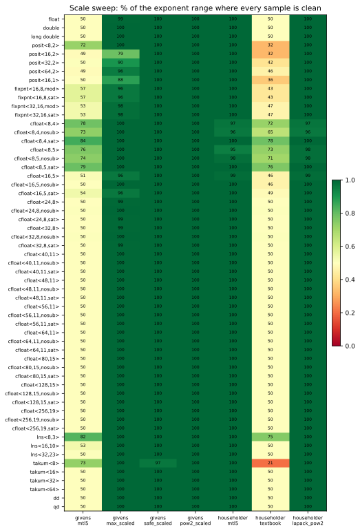

# Givens rotations and Householder reflectors, one at a time

mp-numerics#13, part of the series in stillwater-sc/mtl5#666. This study measures
how a single plane rotation or a single Householder reflector behaves in each
number system, before any factorization is built on them. It tests MTL5's own
kernels, `mtl::apply_givens_rotation` (`operation/givens.hpp`) and
`mtl::householder` (`operation/householder.hpp`), against the forms LAPACK uses
and against two power-of-two-scaled forms written here.

It covers 65 types: the hardware IEEE types, posits, fixed point, the cfloat
matrix from FP8 to 256 bits in three variants, lns, linear takums, and
double-double and quad-double.

## Running it

```bash
cmake --build build --target givens_householder_study
./build/benchmarks/linalg/givens_householder/givens_householder_study results/
python3 benchmarks/linalg/givens_householder/summarize.py results/
python3 benchmarks/linalg/givens_householder/plot.py results/ figures/
```

`--quick` runs a small sample, and `--family ieee,posit,fixpnt,cfloat,lns,takum,dd,qd`
picks families (all by default). The full run takes about four minutes, most
of it in the wide cfloats. Each CSV has a `.sysinfo` sidecar recording the
platform, compiler, sample counts and the commits of mp-numerics, MTL5 and
Universal. The commits are read when CMake configures, so reconfigure before a
run whose results are kept; `+dirty` marks uncommitted changes. The inputs come
from `std::mt19937_64` and `std::cos`/`std::sin`, so another platform's libm can
move an input by an ulp and change the last digits. The committed results are
byte-identical between GCC 15 and Clang 21 on x86-64. `plot.py` needs
matplotlib; `summarize.py` needs only the standard library.

## What is measured

Each operator is built for x = (a, b) and measured exactly. The computed values
are read out of the number type as exact Shewchuk expansions
(`include/sw/mp_numerics/exact.hpp`), so every error below is the error of the
operator the arithmetic produced, rounded once to double for the CSV. Values
beyond double's range are first scaled by a power of two inside the type, which
is exact. lns values are not dyadic and are read through double, which rounds
far below lns<32,23>'s own resolution.

| column | meaning |
|---|---|
| `orth` | ‖QᵀQ − I‖₂ of the computed operator: \|c² + s² − 1\| for a rotation, \|g\|·\|g − 2\| with g = τ vᵀv for a reflector |
| `r_err` | \|stored entry − ‖x‖\| / ‖x‖, for the value a factorization keeps in place of a (r, or the first entry of H x) |
| `annih` | \|second entry of Q x\| / ‖x‖, with Q applied exactly |
| `annih_fp` | the same entry computed in the type |
| `nonfinite` | samples with an infinity or NaN in the operator or its result |
| `identity` | samples where the routine returned the identity |
| `gross` | samples with `orth` or `annih` above max(1/2, 16 eps): the operator is wrong beyond what rounding explains. The 16 eps floor matters only for the 8-bit types. A computed value that, scaled like its data, falls outside double's range cannot be read; it is finite, so it counts as gross, not as `nonfinite`: it is off by a factor near 2^1000. `r_err` is left out, because at the ends of a tapered or fixed-point range it mostly measures how coarsely the type represents ‖x‖ |

`eps` is `std::numeric_limits<T>::epsilon()`, the spacing at 1, and the tables
give errors in units of it. Two cautions in reading them. A tapered type
(posit, takum) is coarser below 1 than at 1, so rounding alone can cost a few
eps. And dd and qd carry a bit or three more than their `epsilon()` (2^-105 and
2^-209) suggests, so their errors can fall below 1 eps.

### The operators

| name | what it is |
|---|---|
| `givens_mtl5` | `mtl::apply_givens_rotation`: r = sqrt(a·a + b·b), c = a/r, s = b/r. GMRES uses it, and MINRES and the symmetric QR iteration use the same formula |
| `givens_max_scaled` | divide by m = max(\|a\|, \|b\|) first, as LAPACK's `lapy2` does; c = a/r |
| `givens_safe_scaled` | Anderson's safe scaling, transcribed from Reference-LAPACK `dlartg.f90` (3.10), its thresholds taken from `std::numeric_limits` |
| `givens_pow2_scaled` | scale by an exact 2^-e with 2^e ≤ max(\|a\|, \|b\|), so the squares sit near 1; c and s from the scaled values |
| `householder_mtl5` | `mtl::householder`: max-scaled, Parlett's sign (onto +‖x‖e₁ for x₀ > 0), v(0) = 1, applied as `qr_solve` applies it |
| `householder_textbook` | `mtl::householder(x, tag::textbook_reflector)`: v = x − αe₁ with α = −sign(x₀)‖x‖, unscaled, unnormalized |
| `householder_lapack_pow2` | `dlarfg`'s sign (onto −sign(x₀)‖x‖e₁) and v(0) = 1, on x scaled by an exact 2^-e |

### The inputs

| input | x | per row |
|---|---|---|
| `base` | random directions, ‖x‖ = 1 | 10000 samples |
| `scale` | random directions, ‖x‖ = 2^k for k across the type's whole range (`param` = k) | 32 samples |
| `tail` | (±1, ±2^-j (1 + u)), j from 0 to 8 past the type's precision (`param` = j) | 32 samples |
| `repeat` | `power`: one operator applied k times to 16 unit vectors (`dev` = max \| ‖y‖ − ‖y₀‖ \| / ‖y₀‖, against the start vector as rounded into the type); `product`: k fresh operators accumulated into an 8 × 8 Q (`dev` = ‖QᵀQ − I‖_F) | 8 and 4 trials |

### The types

| family | types |
|---|---|
| ieee | `float`, `double`, `long double` (x87 80-bit here; the `bits` column records which one ran) |
| posit | posit<8,2>, <16,2>, <32,2>, <64,2>, and posit<16,1> |
| fixpnt | fixpnt<16,8> and <32,16>, each wrapping (`mod`) and saturating (`sat`) |
| cfloat | cfloat<8,4> (FP8 E4M3) and <8,5> (E5M2), <16,5>, <24,8>, <32,8>, <40,11>, <48,11>, <56,11>, <64,11>, <80,15>, <128,15>, <256,19>; the exponent is IEEE's where IEEE defines the size, truncated from the next IEEE size otherwise. Each in three variants: IEEE behaviour (gradual underflow, overflow to infinity), `nosub` (no subnormals) and `sat` (overflow saturates to max). The three variants of a size see the same inputs |
| lns | lns<8,3>, <16,10>, <32,23>: the ranges of E4M3 (2^±8), binary16 (2^±16) and binary32 (2^±128) |
| takum | linear takum<8>, <16>, <32>, <64>, with the specified three regime bits; range 2^±255 |
| dd, qd | `sw::universal::dd` and `qd`: double's range, two and four times its precision |

`test_rotations` checks that cfloat<32,8> and cfloat<64,11> give float's and
double's measures bit for bit through all seven operators, subnormals to overflow,
so the cfloat rows can be read as the corresponding IEEE type's would be.

## Findings

Findings 1 to 7 come from the first part of the study (IEEE, posit, fixpnt) and
hold for the types added since. Findings 8 to 12 are about the added types.

**1. MTL5's rotation fails outside half the exponent range.** a·a overflows
once \|a\| passes sqrt(max), and underflows below sqrt(min), long before r
would. The clean band is k ∈ [−74, 63] for float out of [−149, 127], and
[−533, 509] for double. How it fails depends on the type. In IEEE, r becomes
infinite, so c = s = 0 and the rotation is the zero matrix; or r underflows to
0, and the rotation is the identity with r = 0 stored for ‖x‖. In a posit or a
saturating fixed-point type, the square saturates and the rotation is finite
and wrong. A wrapping fixed-point type wraps. Even inside the band, a posit's
squares land where it has few bits: posit<64,2> reaches 5×10⁸ eps. Every type
added since loses the top half of its range the same way, cfloat<256,19>
included (clean for k ∈ [−130423, 130188] of [−262378, 262143]). The bottom
half fails in the types with IEEE-like underflow. A posit, a takum or an lns
rounds a tiny square up to its smallest value instead, so there the rotation
stays finite and not gross, only inaccurate (finding 8).

**2. `lapy2`'s scaling stops the overflow, but not the loss of accuracy.**
With c = a/r, the error of r at the input's own magnitude goes into c. That
magnitude is subnormal in IEEE, or far from 1 in a posit, where r has few bits.
The operator is not grossly wrong there, but its orthogonality error reaches
0.25: 1.1×10¹⁵ eps in double near the subnormal range, and 1.4×10¹⁷ eps in
posit<64,2>. The cause is the subnormals: in every cfloat without them the
max-scaled rotation is clean across the whole range, within 2.7 eps.

**3. `dlartg`'s safe scaling guards the range, not the precision.** In IEEE
it is what it was designed to be: clean across the whole range, within 2.1 eps,
in every cfloat from 8 to 256 bits too. In a posit it never fails grossly, but
its thresholds come from the range: it scales only when an entry is beyond
sqrt(min) or sqrt(max/2), and inside those bounds a posit's squares fall where
it has few bits. posit<64,2> reaches 5×10⁸ eps and posit<32,2> 9×10³ eps. The
thresholds would have to come from where the type is precise, not from where it
overflows. Findings 10 and 11 show the same for takum and dd.

**4. Scaling by an exact power of two fixes the rotation in every type.**
`givens_pow2_scaled` is clean across the whole range of all 65 types, within
4.6 eps in dd and takum and within 2.2 eps in every other type. The scaling rounds nothing in a
floating-point type and puts the squares near 1.

**5. MTL5's reflector loses accuracy on small tails in tapered and
fixed-point types, because of its choice of sign.** Parlett's sign gives
v₀ = −σ/(x₀ + ‖x‖), which is small when the tail is small, so after
normalizing v(0) = 1 the second entry is v₁ ≈ −2x₀/x₁, which is large. In IEEE
that costs nothing (about 9 eps at worst). In a posit, v₁ and 1 + v₁² land where the
posit has few bits: on the tail sweep posit<32,2> reaches 512 eps and
posit<64,2> 8×10⁵ eps; takum<64> reaches 207 eps. In fixed point, which has
absolute precision, the reflector reaches 2.4×10³ eps in fixpnt<32,16>. In the
tail sweep x₀ = ±1, so MTL5's scaling divides by 1 and rounds nothing: the sign
alone is the cause. With `dlarfg`'s sign, |v₀| = |x₀| + ‖x‖ ≥ ‖x‖, so every
entry of the normalized v is at most 1, and `householder_lapack_pow2` stays
within 8.7 eps for every type, at every scale and every tail (5.4 eps outside
takum). Its only failures are a few non-finite samples in the top binade of
the 8- and 16-bit cfloats with IEEE overflow, where a value the reflector must
form, ‖x‖ or the dot product of its application, overflows the type. MTL5's identity fallback ([mtl5#662](https://github.com/stillwater-sc/mtl5/pull/662)) catches the worst cases, but only
once the error exceeds the tail: from j = 8 in posit<16,2> and j = 40 in
posit<64,2>.

**6. MTL5's textbook reflector is accurate but unscaled.** It has the LAPACK
sign and no normalization, so it is within 6.4 eps on every tail in IEEE,
posits and fixed point, and within 1 eps in fixed point. Its unscaled sum of
squares limits it to the same half-range band as the unscaled rotation.

**7. Repeated application.** One rounded rotation applied k times stretches or
shrinks every vector by about k·\|c² + s² − 1\|/2, so the error grows
linearly: 10³ to 10⁴ eps at k = 4096 (880 to 3.4×10⁴) in every type of 16 bits
or more, whichever way the rotation was computed; qd, at 22 to 109 eps, holds
more bits than its eps counts. A reflector is its own inverse, so applied
repeatedly its errors partly cancel, and how much depends on the operator and
the type: from 6 to 10⁵ eps, and more where a type saturates (finding 9).
Accumulating k fresh operators into an 8 × 8 Q grows far more slowly: 30 to
540 eps at k = 1024 in every type of 16 bits or more. The 8-bit types are too
narrow for it: 230 eps at best (takum<8> with power-of-two scaling) and up to
10¹⁰ eps (E5M2).

**8. Without subnormals, the unscaled forms lose accuracy before they fail.**
A square below the smallest normal flushes to zero instead of losing bits
gradually, so r and c take a relative error up to 1/2 at the bottom of the
band while staying under the gross threshold: MTL5's rotation reaches
6.6×10¹³ eps in cfloat<64,11,nosub> against 1.2 eps in cfloat<64,11>, and
2.7×10⁶ eps in cfloat<32,8,nosub>. lns has no gradual underflow either: a
square below its smallest value rounds up to that value, and MTL5's rotation
reaches 5.7×10⁵ eps in lns<32,23> at the bottom of its band. The scaled forms
never square a small number and are unaffected.

**9. Saturation turns overflow into a large finite error.** In the sweeps the
saturating cfloats behave as the IEEE ones do: their rows are identical but at
the very top of the range, where the norm overflows in IEEE and is clamped
here. In repeated application they differ. A rounded rotation that is slightly
expansive grows a vector until it overflows: in IEEE FP8, some of the 8 power
trials of each rotation end at infinity (1 to 6, depending on the rotation),
and are counted as non-finite. With
saturation the same trials end clamped at max, and the deviation they report is
2.3×10³ eps in E4M3, 2.7×10⁵ eps in E5M2 and 3.9×10⁶ eps for MTL5's reflector
in cfloat<16,5,sat>: wrong, and nothing in the value says so.

**10. Takums behave like posits, but far more gently.** Their precision falls
off toward the ends of the range more slowly than a posit's. `dlartg`'s
scaling reaches 50 to 95 eps (posit<64,2>: 5×10⁸), `lapy2`'s 106 to 126 eps
(posit<64,2>: 1.4×10¹⁷), and MTL5's reflector 30 to 61 eps on the scale sweep
and 207 eps on the tail sweep in takum<64>. The power-of-two forms stay within
3.7 and 7.9 eps. takum<8> is too narrow to say much: at the gross threshold of
2, MTL5's rotation is clean only from k = −239 to 122.

**11. dd and qd hold full precision over less than double's range.** Below
2^-969 the low limb of a dd underflows, so its precision falls toward a
double's. `numeric_limits<dd>` reports double's exponent range all the same,
so `dlartg`'s thresholds (sqrt(min) ≈ 2^-511) let squares into that zone:
6.5×10¹³ eps in dd, 1.4×10⁴⁵ eps in qd, both near 2^-59 in absolute terms.
MTL5's rotation reaches 4.7×10²¹ eps in dd inside its band, from k = −494
down. The power-of-two forms keep the squares near 1 and stay within 3.8 eps.

**12. The wide cfloats behave as IEEE does, at every width.** cfloat<80,15>,
<128,15> and <256,19> reproduce findings 1 to 6: the
unscaled forms are limited to half the range, the scaled ones are clean to
within 2.2 eps, and MTL5's reflector stays within 9 eps. The one excess is at
the bottom edge of the unscaled band, where the squares are subnormal:
1.8×10¹⁹ eps (2^-48) in cfloat<128,15>.

### What this suggests for MTL5

These are candidates, not changes made here, now filed as MTL5 issues:

- `apply_givens_rotation`, and the same formula in MINRES and the symmetric
  QR iteration, could scale by an exact power of two before squaring, as
  `givens_pow2_scaled` does. In IEEE that costs two exponent extractions and
  removes the half-range limit; in a posit, takum, dd, lns or fixed point it
  also keeps the accuracy. It was the only rotation clean and accurate in all
  65 types ([mtl5#671](https://github.com/stillwater-sc/mtl5/issues/671)).
- `householder()` could reflect onto −sign(x₀)‖x‖e₁, as `dlarfg` does. That
  changes the sign of R's diagonal, which MTL5 currently keeps positive
  ([mtl5#672](https://github.com/stillwater-sc/mtl5/issues/672)).
- Thresholds taken from `std::numeric_limits` describe where a type overflows,
  not where it is precise. Tapered types, dd and qd need the second.

### Universal behaviour met along the way

Not changed here; filed in Universal so the results can be read correctly.

- `std::numeric_limits<dd>::max()` is not a normalized pair: its low limb is
  more than half an ulp of its high limb, so it converts to an infinity, and
  `max() * dd(1)` is NaN. The study takes dd's top from double
  ([universal#1882](https://github.com/stillwater-sc/universal/issues/1882)).
- dd and qd products near `DBL_MAX` return NaN: Universal's Dekker split rounds
  the high half of a value near `DBL_MAX` up to 2^1024, so
  `dd(DBL_MAX) * dd(0x1p-512)` is a NaN. dd_cascade's division hits the same
  split. The study scales dd and qd with their own limb-wise `ldexp`
  ([universal#1881](https://github.com/stillwater-sc/universal/issues/1881)).
- `std::numeric_limits<dd>::min()` is 2^-969, where dd still has full
  precision, but `min_exponent` is double's −1021 (finding 11,
  [universal#1882](https://github.com/stillwater-sc/universal/issues/1882)).
- dd's `sqrt` is not correctly rounded: up to 7.9 units of 2^-106 (3.96 dd
  eps) against a qd reference on [1, 4), where dd_cascade's is within 0.75
  ([universal#1883](https://github.com/stillwater-sc/universal/issues/1883)). The cfloat, lns, takum and qd square roots are correctly
  rounded.

## Figures

`plot.py` draws them from `results/` into `figures/`.

| figure | shows |
|---|---|
| `scale_clean_range.svg` | the share of each type's exponent range where every sample is clean, per operator; each sampled exponent counts for the span of exponents it stands for, and one where every input flushes to zero counts as not clean |
| `scale_rotations_*.svg`, `scale_reflectors_*.svg` | worst orthogonality across the exponent range, one panel per type; gross and non-finite rows are drawn in a band above the largest finite error |
| `tail_reflectors_*.svg` | worst orthogonality of the three reflectors across the tail sweep |
| `repeat_power.svg`, `repeat_product.svg` | deviation against k for repeated application, one line per type, over the trials that stayed finite; an x marks a checkpoint where some trials overflowed, a triangle at the top one where all did |



## Tables

Generated by `summarize.py` from `results/`. Each entry is in units of the
type's eps.

### Scale sweep

Each entry gives the range of k with no gross or non-finite sample, then the
worst orthogonality within it.

| type | range of k | `givens_mtl5` | `givens_max_scaled` | `givens_safe_scaled` | `givens_pow2_scaled` | `householder_mtl5` | `householder_textbook` | `householder_lapack_pow2` |
|---|---|---|---|---|---|---|---|---|
| float | -149..127 | -74..63, 3.89 | -147..127, 2.1e+06 | all, 1.99 | all, 1.99 | all, 7.62 | -74..63, 3.5e+06 | all, 4.42 |
| double | -1074..1023 | -533..509, 1.23 | -1072..1023, 1.1e+15 | all, 1.85 | all, 1.46 | all, 8.44 | -533..509, 1.9e+13 | all, 4.31 |
| long double | -16445..16383 | -8186..8124, 1.99 | -16443..16383, 2.3e+18 | all, 1.99 | all, 2.07 | all, 9.09 | -8186..8124, 3.22 | all, 4.76 |
| posit<8,2> | -24..24 | -24..12, 8 | all, 8 | all, 5.75 | all, 1.32 | all, 3.47 | -24..12, 8 | all, 3.22 |
| posit<16,2> | -56..56 | -28..28, 72 | -43..44, 512 | all, 42.5 | all, 1.8 | all, 15.6 | -18..17, 682 | all, 3.83 |
| posit<32,2> | -120..120 | -60..60, 2.0e+04 | -108..108, 3.4e+07 | all, 9.08e+03 | all, 1.98 | all, 69.6 | -49..49, 4.4e+07 | all, 4.76 |
| posit<64,2> | -248..248 | -120..120, 5.0e+08 | -232..239, 1.4e+17 | all, 5.0e+08 | all, 2.01 | all, 33.6 | -114..111, 1.9e+17 | all, 4.28 |
| posit<16,1> | -28..28 | -13..14, 45 | -25..24, 1.02e+03 | all, 45 | all, 1.44 | all, 68.6 | -10..9, 1.36e+03 | all, 3.76 |
| fixpnt<16,8,mod> | -8..6 | -4..3, 16 | -7..6, 64 | all, 12.2 | all, 1.63 | all, 67.4 | -3..2, 59.4 | all, 2.94 |
| fixpnt<16,8,sat> | -8..6 | -4..3, 50.6 | -7..6, 64 | all, 12.2 | all, 1.56 | all, 67.4 | -3..2, 59.4 | all, 2.75 |
| fixpnt<32,16,mod> | -16..14 | -8..7, 327 | -15..14, 1.6e+04 | all, 252 | all, 1.83 | all, 2.01e+03 | -7..6, 1.3e+04 | all, 4.43 |
| fixpnt<32,16,sat> | -16..14 | -8..7, 1.03e+03 | -15..14, 1.6e+04 | all, 1.03e+03 | all, 1.83 | all, 2.08e+03 | -7..6, 2.5e+04 | all, 3.68 |
| cfloat<8,4> | -9..7 | -9..3, 1.06 | all, 8 | all, 1.32 | all, 1.12 | -9..6, 3.47 | -9..2, 3.53 | -9..6, 3.22 |
| cfloat<8,4,nosub> | -6..7 | -6..3, 2.53 | all, 1.32 | all, 1.32 | all, 1.06 | -6..6, 3.47 | -6..2, 2.94 | -6..6, 2.55 |
| cfloat<8,4,sat> | -9..7 | -9..4, 2.62 | all, 8 | all, 1.32 | all, 1.12 | all, 3.47 | -9..3, 3.93 | all, 3.22 |
| cfloat<8,5> | -16..15 | -16..7, 1.31 | all, 1 | all, 1.31 | all, 1.31 | -16..13, 3.22 | -16..6, 3.06 | -16..14, 3.22 |
| cfloat<8,5,nosub> | -14..15 | -14..7, 1.31 | all, 1 | all, 1.31 | all, 1.31 | -14..14, 3.22 | -14..6, 3.06 | -14..14, 3.22 |
| cfloat<8,5,sat> | -16..15 | -16..8, 2.81 | all, 1 | all, 1.31 | all, 1.31 | all, 3.22 | -16..7, 4.16 | all, 3.22 |
| cfloat<16,5> | -24..15 | -12..7, 1.2 | -22..15, 256 | all, 1.79 | all, 1.79 | -24..14, 6.24 | -11..6, 214 | -24..14, 3.89 |
| cfloat<16,5,nosub> | -13..15 | -6..7, 264 | all, 2.23 | all, 1.67 | all, 1.2 | all, 6.23 | -6..6, 240 | all, 3.89 |
| cfloat<16,5,sat> | -24..15 | -12..8, 1.84 | -22..15, 256 | all, 1.79 | all, 1.79 | all, 6.24 | -11..7, 214 | all, 3.89 |
| cfloat<24,8> | -141..127 | -70..63, 1.23 | -139..127, 8.19e+03 | all, 2.08 | all, 2.08 | all, 9.05 | -70..63, 1.4e+04 | all, 4.18 |
| cfloat<24,8,nosub> | -126..127 | -126..63, 1.1e+04 | all, 2.46 | all, 1.74 | all, 1.25 | all, 9.05 | -126..63, 1.0e+04 | all, 4.18 |
| cfloat<24,8,sat> | -141..127 | -70..63, 1.23 | -139..127, 8.19e+03 | all, 2.08 | all, 2.08 | all, 9.05 | -70..63, 1.4e+04 | all, 4.18 |
| cfloat<32,8> | -149..127 | -74..63, 4.11 | -147..127, 2.1e+06 | all, 1.77 | all, 1.68 | all, 8.3 | -74..63, 3.9e+06 | all, 5.24 |
| cfloat<32,8,nosub> | -125..127 | -62..63, 2.7e+06 | all, 2.4 | all, 1.77 | all, 1.28 | all, 8.14 | -62..63, 2.7e+06 | all, 4.25 |
| cfloat<32,8,sat> | -149..127 | -74..63, 4.11 | -147..127, 2.1e+06 | all, 1.77 | all, 1.68 | all, 8.3 | -74..63, 3.9e+06 | all, 5.24 |
| cfloat<40,11> | -1050..1023 | -515..501, 1.26 | -1049..1023, 6.7e+07 | all, 1.77 | all, 1.39 | all, 7.82 | -515..501, 455 | all, 4.66 |
| cfloat<40,11,nosub> | -1021..1023 | -508..509, 3.5e+06 | all, 2.49 | all, 1.77 | all, 1.26 | all, 7.82 | -508..509, 3.5e+06 | all, 4.66 |
| cfloat<40,11,sat> | -1050..1023 | -515..501, 1.26 | -1049..1023, 6.7e+07 | all, 1.77 | all, 1.39 | all, 7.82 | -515..501, 455 | all, 4.66 |
| cfloat<48,11> | -1058..1023 | -521..499, 1.24 | -1056..1023, 1.7e+10 | all, 1.89 | all, 1.89 | all, 7.85 | -521..499, 1.2e+06 | all, 4.45 |
| cfloat<48,11,nosub> | -1021..1023 | -508..509, 1.0e+09 | all, 2.34 | all, 1.87 | all, 1.25 | all, 7.85 | -508..509, 2.0e+08 | all, 4.45 |
| cfloat<48,11,sat> | -1058..1023 | -521..499, 1.24 | -1056..1023, 1.7e+10 | all, 1.89 | all, 1.89 | all, 7.85 | -521..499, 1.2e+06 | all, 4.45 |
| cfloat<56,11> | -1066..1023 | -527..511, 1.23 | -1064..1023, 4.4e+12 | all, 1.78 | all, 1.72 | all, 7.61 | -527..511, 5.2e+09 | all, 4.52 |
| cfloat<56,11,nosub> | -1021..1023 | -508..509, 2.5e+11 | all, 2.46 | all, 1.78 | all, 1.23 | all, 7.61 | -508..509, 2.5e+11 | all, 4.52 |
| cfloat<56,11,sat> | -1066..1023 | -527..511, 1.23 | -1064..1023, 4.4e+12 | all, 1.78 | all, 1.72 | all, 7.61 | -527..511, 5.2e+09 | all, 4.52 |
| cfloat<64,11> | -1074..1023 | -533..509, 1.24 | -1072..1023, 1.1e+15 | all, 1.87 | all, 1.75 | all, 7.68 | -533..509, 2.8e+13 | all, 4.44 |
| cfloat<64,11,nosub> | -1021..1023 | -508..509, 6.6e+13 | all, 2.52 | all, 1.87 | all, 1.27 | all, 7.51 | -508..509, 6.6e+13 | all, 4.44 |
| cfloat<64,11,sat> | -1074..1023 | -533..509, 1.24 | -1072..1023, 1.1e+15 | all, 1.87 | all, 1.75 | all, 7.68 | -533..509, 2.8e+13 | all, 4.44 |
| cfloat<80,15> | -16446..16383 | -8187..8124, 2.07 | -16444..16383, 4.6e+18 | all, 2.07 | all, 2.14 | all, 7.36 | -8187..8124, 3.1 | all, 4.88 |
| cfloat<80,15,nosub> | -16381..16383 | -8139..8140, 2.07 | all, 2.61 | all, 2.07 | all, 2.14 | all, 7.36 | -8139..8140, 3.1 | all, 4.88 |
| cfloat<80,15,sat> | -16446..16383 | -8187..8124, 2.07 | -16444..16383, 4.6e+18 | all, 2.07 | all, 2.14 | all, 7.36 | -8187..8124, 3.1 | all, 4.88 |
| cfloat<128,15> | -16494..16383 | -8223..8112, 1.8e+19 | -16492..16383, 1.3e+33 | all, 1.88 | all, 1.79 | all, 8.88 | -8223..8112, 2.3e+19 | all, 5.07 |
| cfloat<128,15,nosub> | -16381..16383 | -8139..8140, 1.52 | all, 2.7 | all, 1.88 | all, 1.79 | all, 8.88 | -8139..8140, 2.78 | all, 5.07 |
| cfloat<128,15,sat> | -16494..16383 | -8223..8112, 1.8e+19 | -16492..16383, 1.3e+33 | all, 1.88 | all, 1.79 | all, 8.88 | -8223..8112, 2.3e+19 | all, 5.07 |
| cfloat<256,19> | -262378..262143 | -130423..130188, 1.44 | -262376..262143, 2.8e+70 | all, 1.89 | all, 1.45 | all, 8.48 | -130423..130188, 2.85 | all, 4.31 |
| cfloat<256,19,nosub> | -262141..262143 | -130246..130247, 1.44 | all, 2.58 | all, 1.89 | all, 1.52 | all, 8.48 | -130246..130247, 2.85 | all, 4.31 |
| cfloat<256,19,sat> | -262378..262143 | -130423..130188, 1.44 | -262376..262143, 2.8e+70 | all, 1.89 | all, 1.45 | all, 8.48 | -130423..130188, 2.85 | all, 4.31 |
| lns<8,3> | -7..7 | -7..4, 4 | all, 1.44 | all, 1.44 | all, 1 | all, 2.43 | -7..3, 7.15 | all, 2.5 |
| lns<16,10> | -15..15 | -7..8, 484 | all, 1.5 | all, 1.5 | all, 0.994 | all, 3.11 | -7..7, 374 | all, 2.85 |
| lns<32,23> | -127..127 | -62..64, 5.7e+05 | all, 1.5 | all, 1.5 | all, 0.996 | all, 3.34 | -62..63, 5.8e+05 | all, 2.93 |
| takum<8> | -239..239 | -239..122, 8 | all, 8 | -239..239, 8 | all, 1.12 | all, 5.78 | -239..107, 8 | all, 3.28 |
| takum<16> | -255..254 | -127..126, 669 | all, 106 | all, 50.3 | all, 3.65 | all, 30.2 | -127..126, 599 | all, 6 |
| takum<32> | -255..254 | -127..126, 4.5e+07 | all, 126 | all, 55.8 | all, 3.74 | all, 53.6 | -127..126, 4.4e+07 | all, 7.91 |
| takum<64> | -255..254 | -127..126, 1.9e+17 | all, 117 | all, 94.9 | all, 3.65 | all, 60.8 | -127..126, 1.9e+17 | all, 7.62 |
| dd | -1074..1023 | -533..509, 4.7e+21 | -1072..1023, 1.0e+31 | all, 6.5e+13 | all, 3.79 | all, 8.92 | -533..509, 1.9e+29 | all, 4.2 |
| qd | -1074..1023 | -533..509, 9.6e+52 | -1073..1023, 2.1e+62 | all, 1.4e+45 | all, 0.133 | all, 0.187 | -533..509, 3.8e+60 | all, 0.149 |

### Tail sweep

The worst orthogonality, and the first j at which the routine returns the
identity (I). The fixed-point identities of `householder_lapack_pow2` start
where the tail rounds to zero in the type.

| type | `givens_mtl5` | `givens_max_scaled` | `givens_safe_scaled` | `givens_pow2_scaled` | `householder_mtl5` | `householder_textbook` | `householder_lapack_pow2` |
|---|---|---|---|---|---|---|---|
| float | 1.61 | 1.61 | 1.61 | 1.61 | 8.3 (I from j=22) | 3.49 | 4.07 |
| double | 1.77 | 1.66 | 1.77 | 1.77 | 7.43 (I from j=51) | 3.89 | 3.98 |
| long double | 1.66 | 2.26 | 1.66 | 1.66 | 8.53 (I from j=62) | 3.85 | 3.71 |
| posit<8,2> | 1.32 | 1.69 | 1.32 | 1.32 | 3.47 (I from j=3) | 2.53 | 3.22 |
| posit<16,2> | 1.88 | 1.48 | 1.88 | 1.88 | 23.3 (I from j=8) | 3.66 | 4.02 |
| posit<32,2> | 1.79 | 2.22 | 1.79 | 1.79 | 512 (I from j=18) | 3.56 | 3.8 |
| posit<64,2> | 1.91 | 1.91 | 1.91 | 1.91 | 8.0e+05 (I from j=40) | 3.9 | 4.14 |
| posit<16,1> | 1.59 | 2.08 | 1.59 | 1.59 | 56.1 (I from j=6) | 6.31 | 3.63 |
| fixpnt<16,8,mod> | 1.44 | 2.15 | 1.44 | 1.44 | 63.8 (I from j=3) | 0.738 | 2.3 (I from j=10) |
| fixpnt<16,8,sat> | 1.67 | 1.86 | 1.67 | 1.67 | 67.4 (I from j=2) | 0.795 | 2.86 (I from j=10) |
| fixpnt<32,16,mod> | 1.77 | 1.77 | 1.77 | 1.77 | 2.36e+03 (I from j=5) | 0.873 | 2.74 (I from j=18) |
| fixpnt<32,16,sat> | 1.99 | 2.6 | 1.99 | 1.99 | 2.41e+03 (I from j=5) | 0.926 | 2.78 (I from j=18) |
| cfloat<8,4> | 1.32 | 1.69 | 1.32 | 1.32 | 3.47 (I from j=3) | 2.53 | 3.22 (I from j=11) |
| cfloat<8,4,nosub> | 1.32 | 1.69 | 1.32 | 1.32 | 3.47 (I from j=3) | 2.53 | 3.22 (I from j=7) |
| cfloat<8,4,sat> | 1.32 | 1.69 | 1.32 | 1.32 | 3.47 (I from j=3) | 2.53 | 3.22 (I from j=11) |
| cfloat<8,5> | 1 | 1 | 1 | 1 | 3.22 (I from j=1) | 2.57 | 2.33 |
| cfloat<8,5,nosub> | 1 | 1 | 1 | 1 | 3.22 (I from j=1) | 2.57 | 2.33 |
| cfloat<8,5,sat> | 1 | 1 | 1 | 1 | 3.22 (I from j=1) | 2.57 | 2.33 |
| cfloat<16,5> | 1.49 | 1.69 | 1.49 | 1.49 | 5.67 (I from j=8) | 3.53 | 3.46 |
| cfloat<16,5,nosub> | 1.49 | 1.69 | 1.49 | 1.49 | 5.67 (I from j=7) | 3.53 | 3.46 (I from j=15) |
| cfloat<16,5,sat> | 1.49 | 1.69 | 1.49 | 1.49 | 5.67 (I from j=8) | 3.53 | 3.46 |
| cfloat<24,8> | 1.6 | 1.6 | 1.6 | 1.6 | 6.56 (I from j=14) | 3.55 | 3.47 |
| cfloat<24,8,nosub> | 1.6 | 1.6 | 1.6 | 1.6 | 6.56 (I from j=14) | 3.55 | 3.47 |
| cfloat<24,8,sat> | 1.6 | 1.6 | 1.6 | 1.6 | 6.56 (I from j=14) | 3.55 | 3.47 |
| cfloat<32,8> | 1.67 | 1.96 | 1.67 | 1.67 | 7.11 (I from j=22) | 3.71 | 4.02 |
| cfloat<32,8,nosub> | 1.67 | 1.96 | 1.67 | 1.67 | 7.11 (I from j=22) | 3.71 | 4.02 |
| cfloat<32,8,sat> | 1.67 | 1.96 | 1.67 | 1.67 | 7.11 (I from j=22) | 3.71 | 4.02 |
| cfloat<40,11> | 1.55 | 1.7 | 1.55 | 1.55 | 7.18 (I from j=27) | 3.79 | 3.89 |
| cfloat<40,11,nosub> | 1.55 | 1.7 | 1.55 | 1.55 | 7.18 (I from j=27) | 3.79 | 3.89 |
| cfloat<40,11,sat> | 1.55 | 1.7 | 1.55 | 1.55 | 7.18 (I from j=27) | 3.79 | 3.89 |
| cfloat<48,11> | 1.62 | 1.83 | 1.62 | 1.62 | 7.72 (I from j=35) | 3.82 | 3.97 |
| cfloat<48,11,nosub> | 1.62 | 1.83 | 1.62 | 1.62 | 7.72 (I from j=35) | 3.82 | 3.97 |
| cfloat<48,11,sat> | 1.62 | 1.83 | 1.62 | 1.62 | 7.72 (I from j=35) | 3.82 | 3.97 |
| cfloat<56,11> | 1.67 | 1.67 | 1.67 | 1.67 | 7.98 (I from j=43) | 3.73 | 4.06 |
| cfloat<56,11,nosub> | 1.67 | 1.67 | 1.67 | 1.67 | 7.98 (I from j=43) | 3.73 | 4.06 |
| cfloat<56,11,sat> | 1.67 | 1.67 | 1.67 | 1.67 | 7.98 (I from j=43) | 3.73 | 4.06 |
| cfloat<64,11> | 1.59 | 1.59 | 1.59 | 1.59 | 8.19 (I from j=51) | 3.73 | 3.89 |
| cfloat<64,11,nosub> | 1.59 | 1.59 | 1.59 | 1.59 | 8.19 (I from j=51) | 3.73 | 3.89 |
| cfloat<64,11,sat> | 1.59 | 1.59 | 1.59 | 1.59 | 8.19 (I from j=51) | 3.73 | 3.89 |
| cfloat<80,15> | 1.71 | 1.71 | 1.71 | 1.71 | 7.95 (I from j=63) | 3.71 | 3.84 |
| cfloat<80,15,nosub> | 1.71 | 1.71 | 1.71 | 1.71 | 7.95 (I from j=63) | 3.71 | 3.84 |
| cfloat<80,15,sat> | 1.71 | 1.71 | 1.71 | 1.71 | 7.95 (I from j=63) | 3.71 | 3.84 |
| cfloat<128,15> | 1.88 | 2.1 | 1.88 | 1.88 | 7.88 (I from j=111) | 3.8 | 4.08 |
| cfloat<128,15,nosub> | 1.88 | 2.1 | 1.88 | 1.88 | 7.88 (I from j=111) | 3.8 | 4.08 |
| cfloat<128,15,sat> | 1.88 | 2.1 | 1.88 | 1.88 | 7.88 (I from j=111) | 3.8 | 4.08 |
| cfloat<256,19> | 1.5 | 1.5 | 1.5 | 1.5 | 7.72 (I from j=235) | 2.24 | 3.88 |
| cfloat<256,19,nosub> | 1.5 | 1.5 | 1.5 | 1.5 | 7.72 (I from j=235) | 2.24 | 3.88 |
| cfloat<256,19,sat> | 1.5 | 1.5 | 1.5 | 1.5 | 7.72 (I from j=235) | 2.24 | 3.88 |
| lns<8,3> | 1.44 | 1.44 | 1.44 | 1.44 | 2.43 (I from j=4) | 2.09 | 2.09 (I from j=8) |
| lns<16,10> | 1.5 | 1.5 | 1.5 | 1.5 | 2.9 (I from j=8) | 1.97 | 2.9 (I from j=17) |
| lns<32,23> | 1.49 | 1.49 | 1.49 | 1.49 | 3.14 (I from j=25) | 1.99 | 3.14 |
| takum<8> | 2 | 2 | 2 | 1.78 | 6.45 (I from j=1) | 18.3 | 4.18 |
| takum<16> | 2.13 | 2.13 | 2.13 | 2.13 | 29.3 (I from j=7) | 7.26 | 5.15 |
| takum<32> | 3.32 | 1.61 | 3.32 | 3.32 | 96.8 (I from j=22) | 8.88 | 5.75 |
| takum<64> | 2.35 | 2.35 | 2.35 | 2.35 | 207 (I from j=53) | 8.75 | 6.07 |
| dd | 4.56 | 4.56 | 4.56 | 4.56 | 5.21 (I from j=106) | 1.91 | 4.81 |
| qd | 0.081 | 0.065 | 0.081 | 0.081 | 0.159 (I from j=215) | 0.0931 | 0.159 |

### Repeated application

The worst deviation at the largest k, over the trials that stayed finite;
"(n/m inf)" counts the trials that overflowed.

power, k = 4096:

| type | `givens_mtl5` | `givens_max_scaled` | `givens_safe_scaled` | `givens_pow2_scaled` | `householder_mtl5` | `householder_textbook` | `householder_lapack_pow2` |
|---|---|---|---|---|---|---|---|
| float | 2.34e+03 | 3.52e+03 | 2.34e+03 | 2.34e+03 | 147 | 43.2 | 3.56e+03 |
| double | 1.74e+03 | 2.94e+03 | 1.74e+03 | 1.74e+03 | 30.4 | 23.5 | 2.48e+03 |
| long double | 1.87e+03 | 3.46e+03 | 1.87e+03 | 1.87e+03 | 4.71e+03 | 165 | 623 |
| posit<8,2> | 134 | 2.4e+03 | 134 | 134 | 76.2 | 7.63 | 2.45 |
| posit<16,2> | 2.18e+03 | 2.18e+03 | 2.18e+03 | 2.18e+03 | 150 | 14.5 | 28.4 |
| posit<32,2> | 1.43e+03 | 3.33e+03 | 1.43e+03 | 1.43e+03 | 43.8 | 14.4 | 18.3 |
| posit<64,2> | 1.85e+03 | 3.76e+03 | 1.85e+03 | 1.85e+03 | 30.7 | 147 | 1.64e+03 |
| posit<16,1> | 1.73e+03 | 4.7e+03 | 1.73e+03 | 2.27e+03 | 5.4e+04 | 498 | 2.04e+03 |
| fixpnt<16,8,mod> | 3.3e+04 | 3.3e+04 | 3.3e+04 | 3.3e+04 | 3.3e+04 | 7.62 | 5.83 |
| fixpnt<16,8,sat> | 3.4e+04 | 3.3e+04 | 3.4e+04 | 9.44e+03 | 8.5e+03 | 11 | 2.2e+04 |
| fixpnt<32,16,mod> | 5.57e+03 | 3.53e+03 | 5.57e+03 | 2.16e+03 | 1.7e+05 | 8.4 | 629 |
| fixpnt<32,16,sat> | 4.83e+03 | 2.09e+03 | 4.83e+03 | 2.09e+03 | 5.0e+04 | 5.8 | 8.06 |
| cfloat<8,4> | 1.9 (6/8 inf) | 7.86 (5/8 inf) | 1.9 (6/8 inf) | 1.9 (6/8 inf) | 6.75 (1/8 inf) | 4.63 | 3.99 |
| cfloat<8,4,nosub> | 1.9 (6/8 inf) | 7.32 (5/8 inf) | 1.9 (6/8 inf) | 1.9 (6/8 inf) | 6.75 (1/8 inf) | 4.63 | 3.99 |
| cfloat<8,4,sat> | 2.25e+03 | 2.25e+03 | 2.25e+03 | 2.25e+03 | 1.11e+03 | 4.63 | 3.99 |
| cfloat<8,5> | 1.22 (4/8 inf) | 2.49 (1/8 inf) | 1.22 (4/8 inf) | 1.22 (4/8 inf) | 4 | 5.4 | 5.4 |
| cfloat<8,5,nosub> | 1.22 (4/8 inf) | 2.49 (1/8 inf) | 1.22 (4/8 inf) | 1.22 (4/8 inf) | 4 | 5.4 | 5.4 |
| cfloat<8,5,sat> | 2.7e+05 | 2.6e+05 | 2.7e+05 | 2.7e+05 | 4 | 5.4 | 5.4 |
| cfloat<16,5> | 7.96e+03 | 1.6e+04 | 7.96e+03 | 7.96e+03 | 972 (1/8 inf) | 25.3 | 51 |
| cfloat<16,5,nosub> | 7.96e+03 | 1.6e+04 | 7.96e+03 | 7.96e+03 | 972 (1/8 inf) | 25.3 | 51 |
| cfloat<16,5,sat> | 7.96e+03 | 1.6e+04 | 7.96e+03 | 7.96e+03 | 3.9e+06 | 25.3 | 51 |
| cfloat<24,8> | 1.9e+03 | 2.73e+03 | 1.9e+03 | 1.9e+03 | 2.12e+03 | 608 | 6.77e+03 |
| cfloat<24,8,nosub> | 1.9e+03 | 2.73e+03 | 1.9e+03 | 1.9e+03 | 2.12e+03 | 608 | 6.77e+03 |
| cfloat<24,8,sat> | 1.9e+03 | 2.73e+03 | 1.9e+03 | 1.9e+03 | 2.12e+03 | 608 | 6.77e+03 |
| cfloat<32,8> | 1.03e+03 | 2.71e+03 | 1.03e+03 | 1.03e+03 | 5.23e+03 | 76.2 | 255 |
| cfloat<32,8,nosub> | 1.03e+03 | 2.71e+03 | 1.03e+03 | 1.03e+03 | 5.23e+03 | 76.2 | 255 |
| cfloat<32,8,sat> | 1.03e+03 | 2.71e+03 | 1.03e+03 | 1.03e+03 | 5.23e+03 | 76.2 | 255 |
| cfloat<40,11> | 1.09e+03 | 1.09e+03 | 1.09e+03 | 1.09e+03 | 4.31e+03 | 17 | 61.6 |
| cfloat<40,11,nosub> | 1.09e+03 | 1.09e+03 | 1.09e+03 | 1.09e+03 | 4.31e+03 | 17 | 61.6 |
| cfloat<40,11,sat> | 1.09e+03 | 1.09e+03 | 1.09e+03 | 1.09e+03 | 4.31e+03 | 17 | 61.6 |
| cfloat<48,11> | 1.47e+03 | 2.44e+03 | 1.47e+03 | 1.47e+03 | 8.16e+03 | 2.17e+03 | 2.66e+03 |
| cfloat<48,11,nosub> | 1.47e+03 | 2.44e+03 | 1.47e+03 | 1.47e+03 | 8.16e+03 | 2.17e+03 | 2.66e+03 |
| cfloat<48,11,sat> | 1.47e+03 | 2.44e+03 | 1.47e+03 | 1.47e+03 | 8.16e+03 | 2.17e+03 | 2.66e+03 |
| cfloat<56,11> | 878 | 4.08e+03 | 878 | 878 | 1.1e+04 | 121 | 53.1 |
| cfloat<56,11,nosub> | 878 | 4.08e+03 | 878 | 878 | 1.1e+04 | 121 | 53.1 |
| cfloat<56,11,sat> | 878 | 4.08e+03 | 878 | 878 | 1.1e+04 | 121 | 53.1 |
| cfloat<64,11> | 1.77e+03 | 1.77e+03 | 1.77e+03 | 1.77e+03 | 8.04e+03 | 71.1 | 6.93e+03 |
| cfloat<64,11,nosub> | 1.77e+03 | 1.77e+03 | 1.77e+03 | 1.77e+03 | 8.04e+03 | 71.1 | 6.93e+03 |
| cfloat<64,11,sat> | 1.77e+03 | 1.77e+03 | 1.77e+03 | 1.77e+03 | 8.04e+03 | 71.1 | 6.93e+03 |
| cfloat<80,15> | 1.36e+03 | 2.52e+03 | 1.36e+03 | 1.36e+03 | 1.69e+03 | 63.6 | 171 |
| cfloat<80,15,nosub> | 1.36e+03 | 2.52e+03 | 1.36e+03 | 1.36e+03 | 1.69e+03 | 63.6 | 171 |
| cfloat<80,15,sat> | 1.36e+03 | 2.52e+03 | 1.36e+03 | 1.36e+03 | 1.69e+03 | 63.6 | 171 |
| cfloat<128,15> | 2.26e+03 | 3.76e+03 | 2.26e+03 | 2.26e+03 | 7.73e+03 | 97.4 | 117 |
| cfloat<128,15,nosub> | 2.26e+03 | 3.76e+03 | 2.26e+03 | 2.26e+03 | 7.73e+03 | 97.4 | 117 |
| cfloat<128,15,sat> | 2.26e+03 | 3.76e+03 | 2.26e+03 | 2.26e+03 | 7.73e+03 | 97.4 | 117 |
| cfloat<256,19> | 1.55e+03 | 2.4e+03 | 1.55e+03 | 1.55e+03 | 4.92e+03 | 3.61e+03 | 2.69e+03 |
| cfloat<256,19,nosub> | 1.55e+03 | 2.4e+03 | 1.55e+03 | 1.55e+03 | 4.92e+03 | 3.61e+03 | 2.69e+03 |
| cfloat<256,19,sat> | 1.55e+03 | 2.4e+03 | 1.55e+03 | 1.55e+03 | 4.92e+03 | 3.61e+03 | 2.69e+03 |
| lns<8,3> | 2.99e+03 | 2.99e+03 | 2.99e+03 | 2.99e+03 | 2.04e+03 | 871 | 1.86e+03 |
| lns<16,10> | 4.15e+03 | 3.08e+03 | 4.15e+03 | 4.15e+03 | 2.2e+04 | 2.2e+04 | 2.2e+04 |
| lns<32,23> | 2.05e+03 | 2.65e+03 | 2.05e+03 | 2.05e+03 | 4.1e+03 | 4.1e+03 | 4.1e+03 |
| takum<8> | 71.2 | 71.2 | 71.2 | 71.2 | 6.08 | 11.1 | 2.78 |
| takum<16> | 2.72e+03 | 9.13e+03 | 2.72e+03 | 2.72e+03 | 1.87e+03 | 1.02e+03 | 267 |
| takum<32> | 2.27e+03 | 2.78e+03 | 2.27e+03 | 1.74e+03 | 9.7e+03 | 4.33e+03 | 68 |
| takum<64> | 1.51e+03 | 1.51e+03 | 1.51e+03 | 4.08e+03 | 7.92e+03 | 244 | 1.1e+04 |
| dd | 3.5e+03 | 6.31e+03 | 3.5e+03 | 3.5e+03 | 5.39e+03 | 205 | 5.29e+03 |
| qd | 22.1 | 109 | 22.1 | 22.1 | 143 | 112 | 36.9 |

product, k = 1024:

| type | `givens_mtl5` | `givens_max_scaled` | `givens_safe_scaled` | `givens_pow2_scaled` | `householder_mtl5` | `householder_textbook` | `householder_lapack_pow2` |
|---|---|---|---|---|---|---|---|
| float | 163 | 127 | 165 | 163 | 94.5 | 104 | 89.2 |
| double | 183 | 124 | 173 | 183 | 87.3 | 98.7 | 92.9 |
| long double | 250 | 60.8 | 251 | 250 | 109 | 113 | 86.2 |
| posit<8,2> | 1.3e+04 | 4.2e+04 | 8.62e+03 | 1.3e+04 | 4.6e+04 | 1.2e+05 | 1.75e+03 |
| posit<16,2> | 158 | 193 | 165 | 159 | 94.7 | 106 | 109 |
| posit<32,2> | 161 | 149 | 163 | 164 | 86.2 | 116 | 86.7 |
| posit<64,2> | 239 | 39.6 | 243 | 249 | 101 | 107 | 93.4 |
| posit<16,1> | 141 | 171 | 150 | 160 | 100 | 143 | 107 |
| fixpnt<16,8,mod> | 508 | 104 | 514 | 85.4 | 200 | 212 | 242 |
| fixpnt<16,8,sat> | 466 | 107 | 487 | 105 | 231 | 175 | 227 |
| fixpnt<32,16,mod> | 417 | 125 | 427 | 84.2 | 224 | 195 | 235 |
| fixpnt<32,16,sat> | 410 | 92 | 388 | 90.7 | 229 | 181 | 218 |
| cfloat<8,4> | 2.1e+04 | 7.5e+04 | 1.0e+04 | 2.1e+04 | 6.8e+04 (2/4 inf) | - (4/4 inf) | 1.04e+03 |
| cfloat<8,4,nosub> | 1.9e+04 | 5.1e+04 | 2.2e+04 | 1.9e+04 | 3.4e+05 (2/4 inf) | - (4/4 inf) | 826 |
| cfloat<8,4,sat> | 2.1e+04 | 7.5e+04 | 1.0e+04 | 2.1e+04 | 4.2e+05 | 1.8e+05 | 1.04e+03 |
| cfloat<8,5> | 1.3e+08 | 4.0e+05 | 6.6e+07 | 1.3e+08 | 4.6e+04 | - (4/4 inf) | 7.0e+06 |
| cfloat<8,5,nosub> | 1.3e+08 | 4.0e+05 | 6.6e+07 | 1.3e+08 | 4.6e+04 | - (4/4 inf) | 7.0e+06 |
| cfloat<8,5,sat> | 1.3e+08 | 4.0e+05 | 6.6e+07 | 1.3e+08 | 4.6e+04 | 1.4e+10 | 7.0e+06 |
| cfloat<16,5> | 164 | 191 | 165 | 164 | 94.6 | 130 | 88.9 |
| cfloat<16,5,nosub> | 166 | 194 | 165 | 166 | 89.9 | 122 | 105 |
| cfloat<16,5,sat> | 164 | 191 | 165 | 164 | 94.6 | 130 | 88.9 |
| cfloat<24,8> | 173 | 136 | 169 | 173 | 87.8 | 92.5 | 88.1 |
| cfloat<24,8,nosub> | 173 | 136 | 169 | 173 | 87.8 | 92.5 | 88.1 |
| cfloat<24,8,sat> | 173 | 136 | 169 | 173 | 87.8 | 92.5 | 88.1 |
| cfloat<32,8> | 174 | 144 | 168 | 174 | 89.4 | 116 | 89.9 |
| cfloat<32,8,nosub> | 174 | 144 | 168 | 174 | 89.4 | 116 | 89.9 |
| cfloat<32,8,sat> | 174 | 144 | 168 | 174 | 89.4 | 116 | 89.9 |
| cfloat<40,11> | 160 | 149 | 159 | 160 | 97.5 | 109 | 87.8 |
| cfloat<40,11,nosub> | 160 | 149 | 159 | 160 | 97.5 | 109 | 87.8 |
| cfloat<40,11,sat> | 160 | 149 | 159 | 160 | 97.5 | 109 | 87.8 |
| cfloat<48,11> | 171 | 131 | 154 | 171 | 97 | 96.8 | 94.6 |
| cfloat<48,11,nosub> | 171 | 131 | 154 | 171 | 97 | 96.8 | 94.6 |
| cfloat<48,11,sat> | 171 | 131 | 154 | 171 | 97 | 96.8 | 94.6 |
| cfloat<56,11> | 172 | 120 | 173 | 172 | 90.2 | 102 | 87.1 |
| cfloat<56,11,nosub> | 172 | 120 | 173 | 172 | 90.2 | 102 | 87.1 |
| cfloat<56,11,sat> | 172 | 120 | 173 | 172 | 90.2 | 102 | 87.1 |
| cfloat<64,11> | 164 | 112 | 163 | 164 | 82 | 120 | 79.5 |
| cfloat<64,11,nosub> | 164 | 112 | 163 | 164 | 82 | 120 | 79.5 |
| cfloat<64,11,sat> | 164 | 112 | 163 | 164 | 82 | 120 | 79.5 |
| cfloat<80,15> | 240 | 43.2 | 233 | 240 | 103 | 104 | 105 |
| cfloat<80,15,nosub> | 240 | 43.2 | 233 | 240 | 103 | 104 | 105 |
| cfloat<80,15,sat> | 240 | 43.2 | 233 | 240 | 103 | 104 | 105 |
| cfloat<128,15> | 47.6 | 43.5 | 46.1 | 47.6 | 85.2 | 87.2 | 94.3 |
| cfloat<128,15,nosub> | 47.6 | 43.5 | 46.1 | 47.6 | 85.2 | 87.2 | 94.3 |
| cfloat<128,15,sat> | 47.6 | 43.5 | 46.1 | 47.6 | 85.2 | 87.2 | 94.3 |
| cfloat<256,19> | 38.1 | 43.6 | 31.7 | 38.1 | 83.9 | 97.5 | 78 |
| cfloat<256,19,nosub> | 38.1 | 43.6 | 31.7 | 38.1 | 83.9 | 97.5 | 78 |
| cfloat<256,19,sat> | 38.1 | 43.6 | 31.7 | 38.1 | 83.9 | 97.5 | 78 |
| lns<8,3> | 286 | 1.5e+04 | 293 | 286 | 1.2e+04 | 2.1e+05 | 591 |
| lns<16,10> | 39.3 | 41.8 | 39.1 | 39.3 | 114 | 131 | 120 |
| lns<32,23> | 33.4 | 41.9 | 33.6 | 33.4 | 125 | 132 | 125 |
| takum<8> | 1.7e+04 | 3.8e+03 | 5.28e+03 | 230 | 714 | 1.8e+04 | 2.32e+03 |
| takum<16> | 173 | 168 | 174 | 100 | 159 | 228 | 156 |
| takum<32> | 168 | 117 | 171 | 79.7 | 149 | 228 | 152 |
| takum<64> | 214 | 75.4 | 211 | 381 | 143 | 234 | 151 |
| dd | 140 | 539 | 145 | 140 | 372 | 53.8 | 366 |
| qd | 1.49 | 1.39 | 1.35 | 1.49 | 2.59 | 1.21 | 3.07 |
